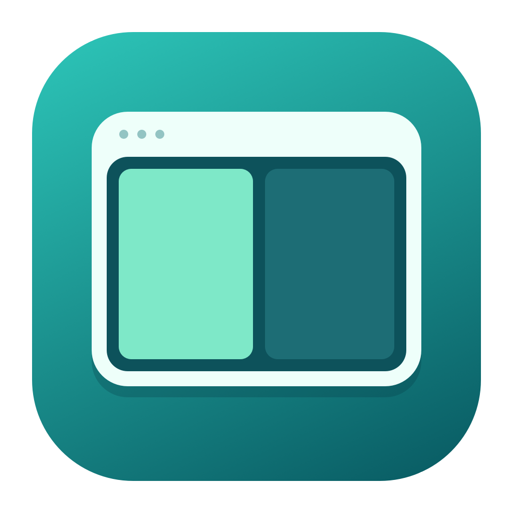

<p align="center"></p>

# WindowSnap

**창 정리, 손끝에서.**

[소개 페이지](https://evans-kim.github.io/windowsnap/) · [Mac용 다운로드](https://github.com/evans-kim/windowsnap/releases/latest/download/WindowSnap-universal.zip) · [릴리스](https://github.com/evans-kim/windowsnap/releases)

## 다운로드 및 설치

릴리스의 `WindowSnap-universal.zip`은 **Apple Silicon·Intel 공용** 앱입니다. 압축을 풀고 `WindowSnap.app`을 응용 프로그램 폴더로 옮기세요. macOS 13 이상이 필요합니다.

현재 공개 배포본은 임시 서명이며 **Apple Developer ID 서명과 공증이 없습니다**. macOS가 실행을 차단하면 출처를 확인한 뒤 시스템 설정 → 개인정보 보호 및 보안에서 ‘확인 없이 열기’를 선택하세요. [Apple 안내](https://support.apple.com/ko-kr/102445)

실행 후 시스템 설정 → 개인정보 보호 및 보안 → 손쉬운 사용에서 WindowSnap을 허용하세요. 처음 실행할 때 로그인 시 자동 실행을 등록하며 앱 설정에서 끌 수 있습니다.

## 기능

macOS 13 이상에서 활성 창을 키보드로 배치하는 Swift 메뉴 막대 앱입니다. 외부 패키지를 사용하지 않습니다.

| 단축키 | 첫 입력 | 같은 방향을 0.8초 이내 재입력 |
| --- | --- | --- |
| ⌥⌘ ← | 왼쪽 1/2 | 왼쪽 1/3 |
| ⌥⌘ → | 오른쪽 1/2 | 오른쪽 1/3 |
| ⌥⌘ ↑ | 위쪽 1/2 | 위쪽 1/3 |
| ⌥⌘ ↓ | 아래쪽 1/2 | 아래쪽 1/3 |

연속 입력 중에는 1/3을 유지합니다. 0.8초가 지나거나 방향 또는 대상 창이 달라지면 1/2로 시작합니다. 키를 길게 누르는 자동 반복은 연속 입력으로 세지 않습니다.

**왼쪽 또는 오른쪽 배치 직후 0.8초 안에 위쪽 단축키를 누르면 같은 창을 최대화합니다.** Dock과 메뉴 막대를 제외한 화면 전체 영역을 채우며 별도의 전체 화면 Space로 이동하지 않습니다. 변경한 방향별 단축키에도 동일하게 적용됩니다.

## 빌드 및 실행

Xcode 또는 Swift 5.9 이상의 Command Line Tools가 필요합니다.

```sh
bash scripts/build-app.sh
open dist/WindowSnap.app
```

처음 실행하면 사용 안내가 표시됩니다. **시스템 설정 → 개인정보 보호 및 보안 → 손쉬운 사용**에서 WindowSnap을 허용한 후, 원하는 앱의 창을 선택하고 단축키를 누르세요. 목록에 없다면 `+`로 생성된 앱을 추가하세요. 메뉴 막대의 분할 사각형 아이콘에서 권한, 마지막 배치 결과, 일시 정지, 종료를 사용할 수 있습니다.

기본 로컬 빌드는 현재 Mac 아키텍처용이며 로컬 ad-hoc 서명을 사용합니다. 앱을 옮기거나 다시 빌드한 후 권한이 작동하지 않으면 손쉬운 사용 목록에서 이전 항목을 제거하고 다시 추가하세요. 배포용 Developer ID 서명과 공증은 포함되지 않았습니다.

권한 안내는 단축키 입력 중 자동으로 열리지 않습니다. 앱 설정에 현재 실행 파일의 실제 권한 상태를 표시하며 2초마다 다시 확인합니다. 이미 허용했는데 미허용으로 표시되면 **설정 → 손쉬운 사용 → 현재 앱 위치**로 실행 중인 앱을 확인하고, 시스템 손쉬운 사용 목록의 이전 WindowSnap을 제거한 다음 현재 앱을 추가해 허용하세요. 앱이 시스템 권한을 자동 변경하지 않습니다.

임시 서명의 앱 식별 요건은 빌드 내용에 따라 달라집니다([Apple 설명](https://developer.apple.com/documentation/technotes/tn3127-inside-code-signing-requirements)). 빌드 간 권한 유지를 위해 설치된 동일한 서명 인증서를 사용하려면 `WINDOWSNAP_SIGN_IDENTITY="인증서 이름" bash scripts/build-app.sh`로 빌드하세요. 기본값은 로컬 임시 서명이며, 서명 인증서가 없으면 빌드 후 재허용이 필요할 수 있습니다.

## 설정

메뉴 막대의 WindowSnap 아이콘 → **설정…**에서 변경합니다.

- **Mac 로그인 시 자동 실행**: 즉시 반영되며 macOS 로그인 항목의 실제 상태를 표시합니다. 이 버전을 처음 실행하면 자동 실행을 한 번 등록합니다. 이후 앱이나 시스템 설정에서 끈 선택은 다음 실행에도 유지됩니다. 등록에 실패하면 설정 화면에서 다시 켤 수 있습니다.
- **방향별 단축키**: 각 방향의 Control/Option/Shift/Command 및 방향키·영문 문자·숫자·F1–F12 조합을 선택한 뒤 **단축키 저장**을 누릅니다. 문자 키는 영문 키보드의 물리적 위치 기준입니다. Command, Option, Control 중 하나 이상이 필요합니다.
- 중복 단축키는 저장할 수 없습니다. 전역 단축키 등록 실패 시 기존 설정을 유지하고 기존 단축키 등록을 복원합니다. macOS가 예약한 단축키 또는 앱 내부 단축키는 등록 후에도 우선순위에 영향을 줄 수 있습니다.
- 기본 단축키로 복원한 뒤 저장하면 ⌥⌘ 방향키로 돌아갑니다. 설정은 앱 종료 및 재로그인 후에도 유지됩니다. 일시 정지 상태에서 저장하면 일시 정지를 유지합니다.
- macOS가 자동 실행 승인을 요구하면 **로그인 항목 승인하기…**로 시스템 설정을 엽니다. 자동 실행은 재부팅 후 사용자 로그인 시 작동합니다. 앱은 등록한 위치에 보관하세요.

자동 실행은 Apple의 [SMAppService.mainApp](https://developer.apple.com/documentation/servicemanagement/smappservice/mainapp)으로 관리하며 별도 LaunchAgent를 만들지 않습니다.

## 동작 범위

- 창이 가장 많이 걸쳐 있는 모니터의 사용 가능 영역을 기준으로 배치합니다. 메뉴 막대와 Dock을 제외합니다.
- 왼쪽/오른쪽은 폭, 위쪽/아래쪽은 높이를 나눕니다.
- 앱이 정한 최소 크기는 유지되므로 일부 창은 정확히 1/3까지 줄어들지 않을 수 있습니다.
- 전체 화면 창과 크기를 바꿀 수 없는 창은 상태 메시지로 안내합니다.
- 다른 앱이 단축키를 선점하면 등록 실패를 표시합니다. 해당 앱의 단축키를 해제하고 메뉴에서 다시 시작하세요.

## 검증

```sh
CLANG_MODULE_CACHE_PATH="$PWD/.build/clang-module-cache" swift test --disable-sandbox
```

자동 테스트는 네 방향의 1/2·1/3 배치, 다중 화면 좌표와 화면 선택, 연속 입력 조건, 단축키 중복·유효성 검사, 설정 저장·복원 및 손상된 설정 복구를 검증합니다. 실제 창 제어는 손쉬운 사용 권한이 있는 로그인 세션에서 별도 확인해야 합니다.

수동 확인: 일반 앱 창에서 네 방향을 한 번/두 번 누르고, 0.8초 후 재입력, 방향 변경, 대상 창 변경, 키 길게 누르기, 외부 모니터, 최소 크기가 큰 창을 확인합니다.

## 구성

- `Sources/SnapCore`: 화면 계산 및 연속 입력 판단
- `Sources/WindowSnap`: AppKit 메뉴, Carbon 전역 단축키, Accessibility 창 제어
- `Tests/SnapCoreTests`: 배치 및 입력 규칙 테스트
- `scripts/build-app.sh`: 로컬 `.app` 생성

권한 확인과 창 제어에는 Apple의 [Accessibility API](https://developer.apple.com/documentation/applicationservices/1460720-axisprocesstrusted)를 사용합니다.

## 배포 및 소개 페이지 관리

```sh
# 아이콘 디자인을 수정한 경우 macOS에서 다시 생성
bash scripts/generate-icon.sh

# 양쪽 CPU를 지원하는 앱, ZIP, SHA-256 체크섬 생성
bash scripts/package-release.sh

# 소개 페이지 로컬 미리보기
python3 -m http.server 8080 --directory docs
```

- `scripts/generate-icon.swift`: 크기별로 렌더링하는 기하학적 아이콘 원본
- `Resources/AppIcon.icns`: 앱 번들 아이콘, `docs/assets/app-icon.png`: 웹 아이콘
- `docs/`: 외부 라이브러리가 없는 한국어 소개 페이지와 클릭형 배치 데모
- `.github/workflows/pages.yml`: `main`의 `docs/` 변경을 GitHub Pages에 게시
- `.github/workflows/release.yml`: 테스트와 Universal 앱 빌드, `v*` 태그에서 GitHub Release 게시

저장소 **Settings → Pages → Source**는 **GitHub Actions**로 지정합니다. 새 버전을 배포할 때는 `Resources/Info.plist`의 버전·빌드 번호, 소개 페이지의 버전과 `RELEASE_NOTES.md`를 업데이트하고 같은 버전의 태그를 푸시합니다. 릴리스 작업은 태그와 앱 버전이 일치하는지 검사합니다.
